# loteria_dolorena

## Imágenes de pruebas

### Ronda 1: La baraja completa
**Rojo:** la prueba falla porque `baraja.dart` no existe.
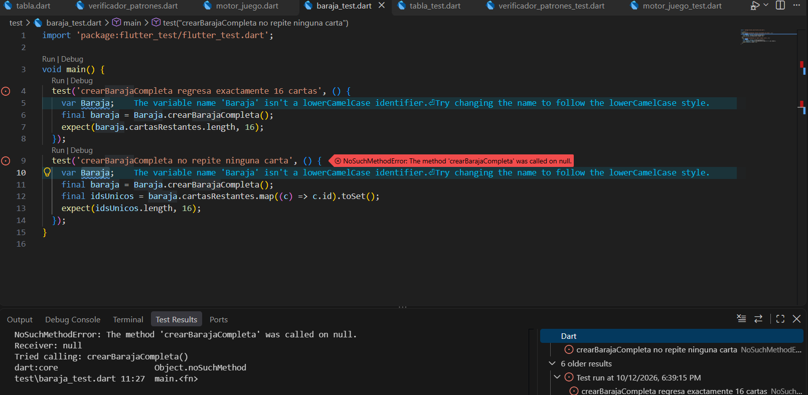

**Verde:** las 2 pruebas pasan.

### Ronda 2: Barajar sin perder cartas
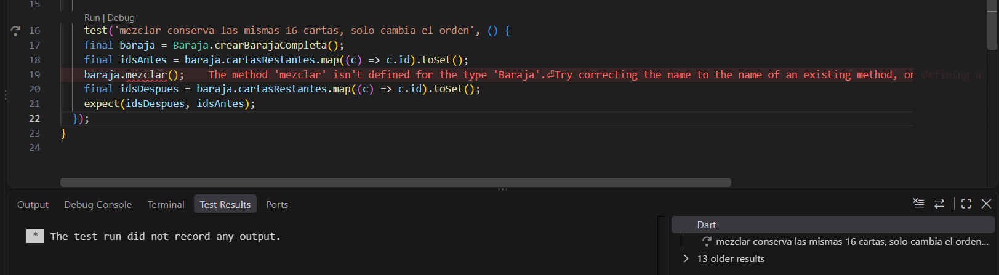
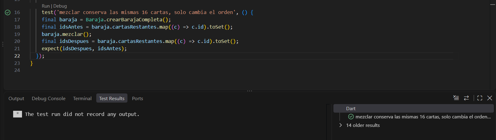

### Ronda 3: Cantar cartas
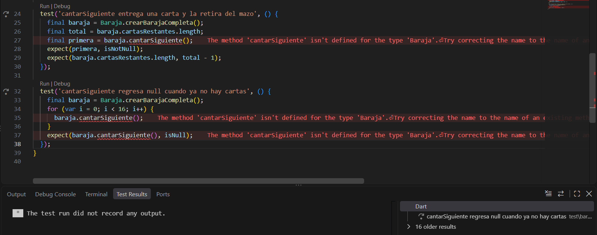
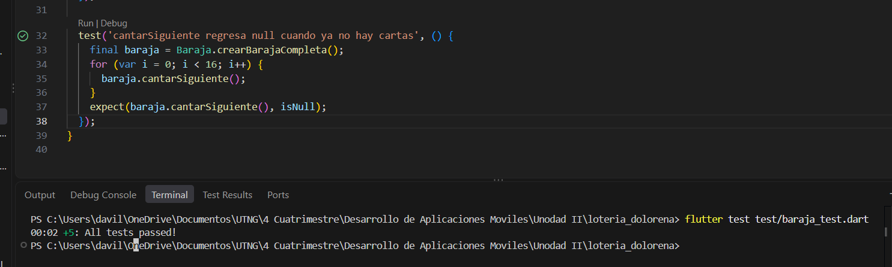

**Refactor:** `removeAt(0)` cambia a `removeLast()` y las pruebas siguen en verde.
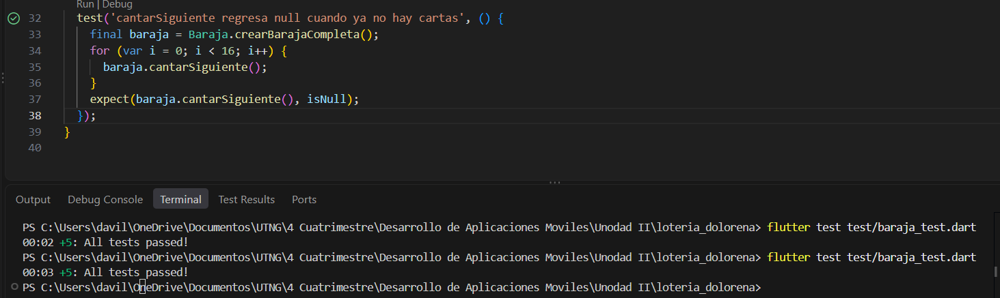

### Ronda 4: La tabla de 4x4
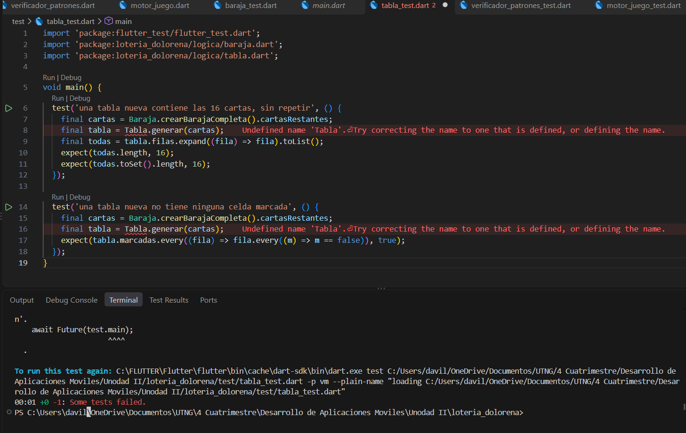
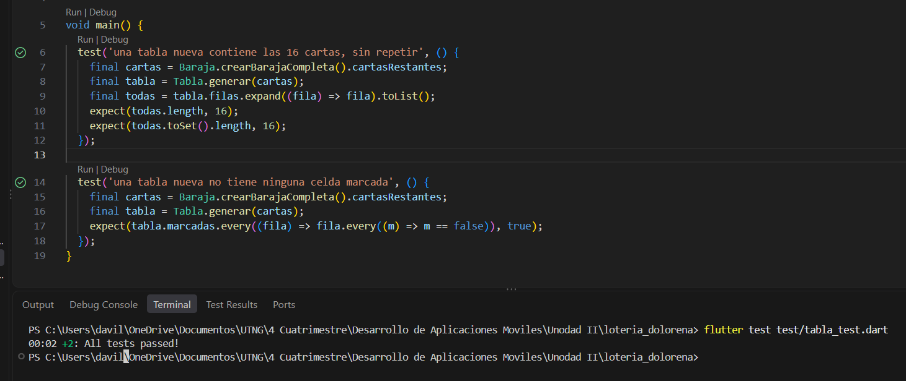

### Ronda 5: Marcar una carta
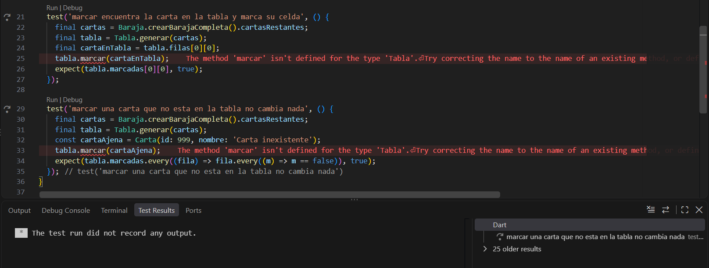
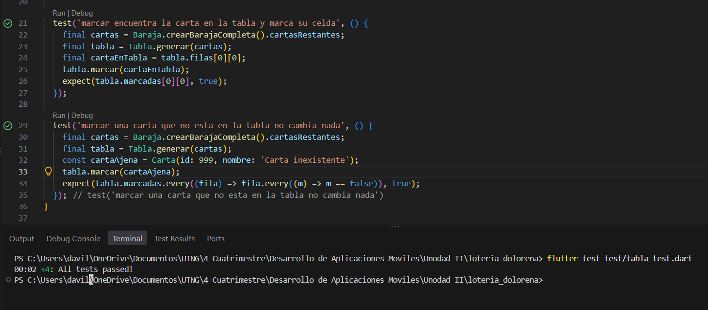

### Ronda 6: Línea horizontal
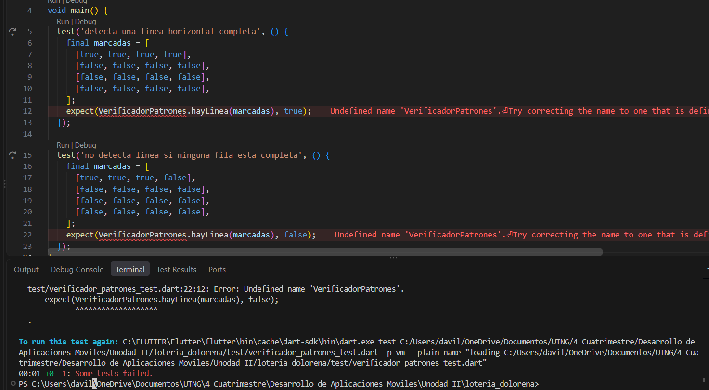
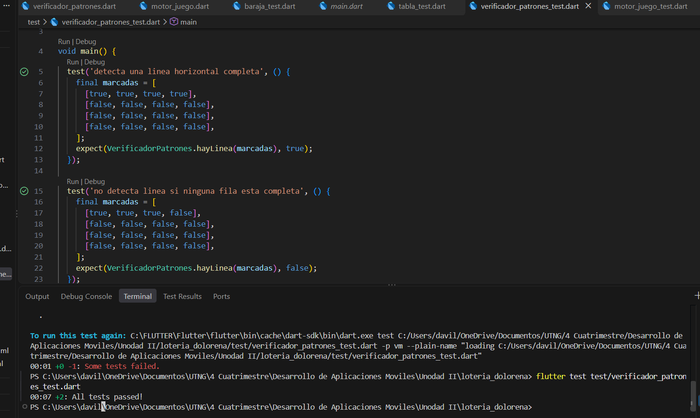

### Ronda 7: Columna
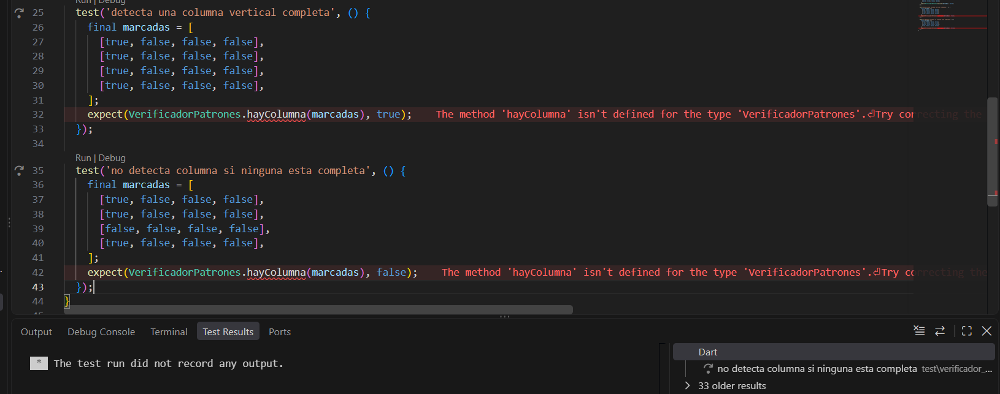
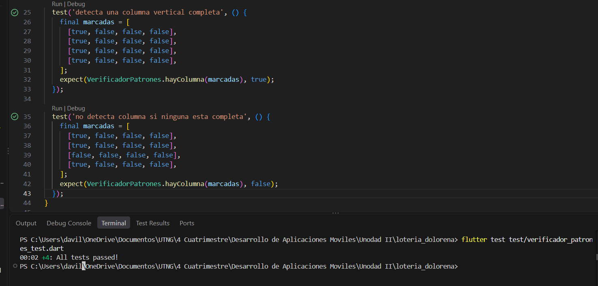

### Ronda 8: Diagonal
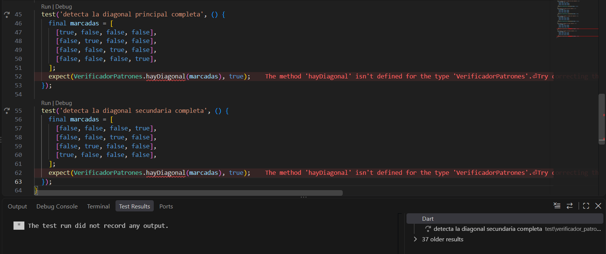
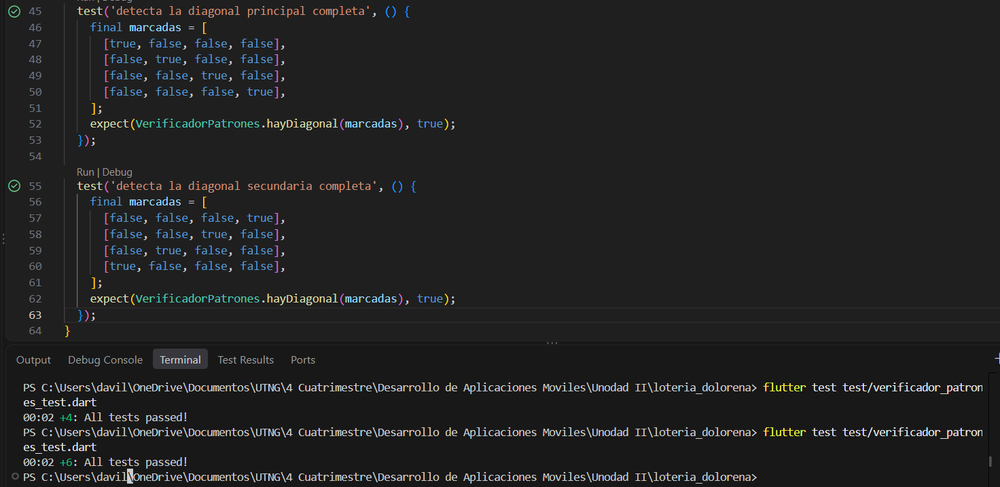

**Refactor:** se agrega `hayGanador`.
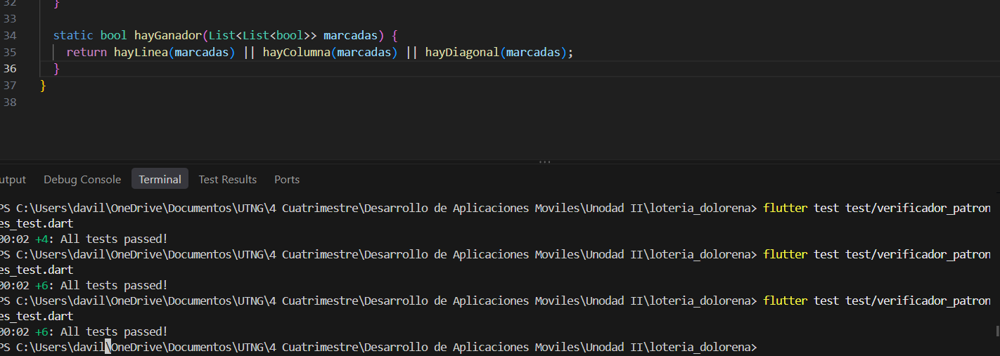

### Ronda 10: Motor de juego
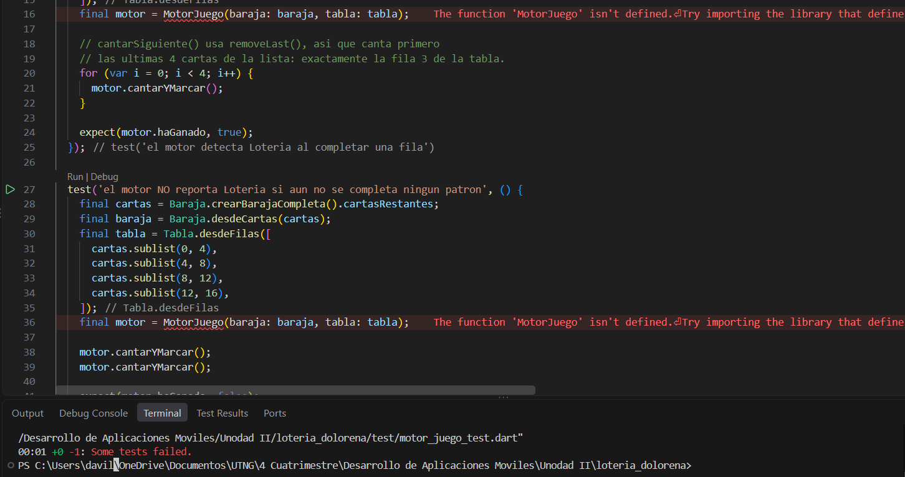
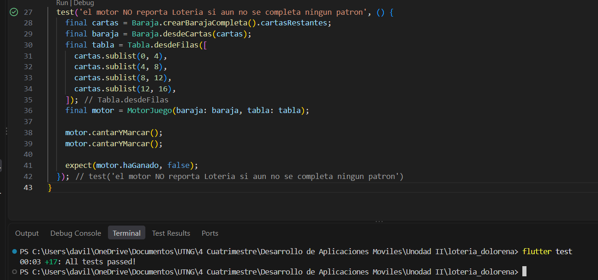
